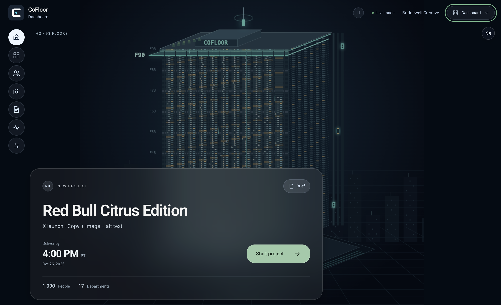
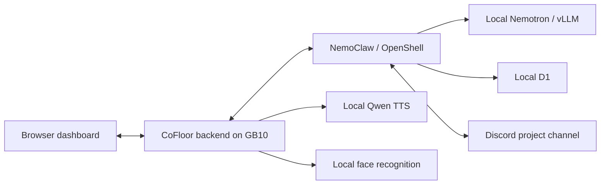

# CoFloor

**A local AI-powered digital office where people and AI agents coordinate projects together.**

A project brief becomes a staffed task board. When someone becomes unavailable, CoFloor proposes a concrete replacement plan in Discord and waits for the project manager to confirm. The dashboard, voice updates, and animated office keep the team informed as the plan changes.

Built for the Dell × NVIDIA AI Hackathon. The frontend, backend, agent harness, and model services run on a **Dell Pro Max with GB10**. Model inference stays on the machine.

## See the workflow

Our demo uses a fictional Red Bull Citrus Edition launch and a synthetic company directory.

1. **Start the project.** Nemotron interprets the brief and creates tasks. D1 selects from eligible staff; the backend checks skills, permissions, availability, and scheduling constraints. Alex Morgan is the demo's designated image creator.
2. **Bring the team together.** NemoClaw posts the assignments to the real Discord project channel. The dashboard shows owners, deadlines, and dependencies.
3. **Handle a real reply.** The person playing Alex replies to the assignment message with a sick-leave report. CoFloor identifies the affected work and uses D1 through NemoClaw to select a validated replacement plan.
4. **Keep the manager in control.** CoFloor posts the proposed changes and mentions the manager. Only the configured manager's direct confirmation of the current proposal applies the reassignment.
5. **Keep everyone informed.** The board updates and local Qwen TTS narrates project milestones. Duplicate messages do not apply the same change twice.

The leave event comes from Discord, not a timer. Employee acceptance replies are not fabricated. This demo coordinates work; it does not generate or publish the campaign assets.

## One machine, several specialists

| Component | Role |
| --- | --- |
| React + TypeScript | Animated office, task board, project activity, and voice controls |
| Node.js backend | Validates assignments, persists runs, coordinates jobs, and enforces confirmation rules |
| NVIDIA NemoClaw + OpenShell | Agent harness, sandbox, local inference routing, and Discord transport |
| Nemotron via vLLM | Reads the brief and generates the project plan, with speculative decoding |
| D1 decision model | Selects eligible owners and validated reassignment plans |
| Qwen TTS | Generates spoken project updates locally |
| OpenCV YuNet + SFace | Optional teammate face-recognition welcome demo |



Model calls use private Spark endpoints, with no cloud model fallback. Discord carries project messages; an optional Cloudflare tunnel exposes the UI. Neither provides model inference. See the [local-inference review guide](qubemc-demo/deploy/spark/LOCAL_INFERENCE.md) for code paths and verification.

Repeated project starts can reuse a cached plan after eligibility is revalidated. Reassignments are evaluated afresh. The allocation animation stays visible for at least five seconds, even when the cache returns immediately.

## Run the app

Use **Node.js 22+** and clone the full repository, including `assets/`.

```sh
git clone https://github.com/anne-creator/Aigeo-plus.git
cd Aigeo-plus/qubemc-demo
npm ci
cp .env.example .env.local
npm run dev
```

Open the local URL printed by Vite. These commands start the web app; live project allocation also requires the local model services and a configured NemoClaw sandbox. Real Discord interaction requires a bot and two configured user accounts. Follow the [app setup guide](qubemc-demo/README.md) to connect them.

**Demo availability:** the hackathon's public tunnel was temporary. There is no permanent hosted demo; the UI and model services require the Spark to be running.

## Explore the project

- [App setup and development](qubemc-demo/README.md)
- [Spark runtime and deployment helpers](qubemc-demo/deploy/spark/README.md)
- [Local-inference verification](qubemc-demo/deploy/spark/LOCAL_INFERENCE.md)
- [Face recognition setup](qubemc-demo/face/README.md)
- [Demo project brief](qubemc-demo/data/projects/red-bull-x-launch/RED_BULL_X_LAUNCH_DEMO.md)
- [Synthetic company data](qubemc-demo/data/company/README.md)

## Check the code

```sh
cd qubemc-demo
npm test
npm run test:board
npm run build
```

Offline checks cover assignment constraints, cached allocations, reassignment, Discord identity and reply validation, duplicate handling, and UI state. Live integration needs the configured Spark services; offline tests alone do not establish live connectivity.

The face-recognition experience is a welcome demo, not production authentication or liveness verification. The company, employees, and campaign scenario are fictional test data.
