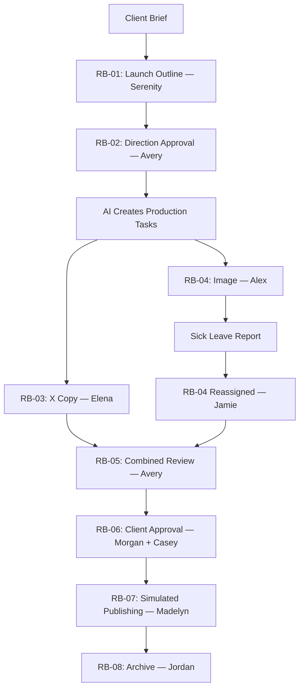

# Red Bull X Launch — AI CEO Demo

> Implementation brief for the hackathon team. English-language mock project using the existing 1,000-person agency dataset. Red Bull Citrus Edition and this client engagement are fictional demo scenarios.

## 1. What we are building

A client requests one X post announcing a new product. The local AI assigns a strategist to write a launch outline. After a Creative Director approves it, the AI turns the outline into specific copy and design tasks and assigns suitable employees.

The first-choice designer reports sick leave. The AI updates availability, rechecks the second-choice designer, transfers the task and its context, and keeps the copy work moving. When both outputs arrive, the project progresses through combined review, client approval, simulated publishing and archive.

**The three main demo moments:**

1. One approved outline becomes two concrete production tasks.
2. The first-choice designer becomes unavailable; the second choice takes over.
3. Two parallel outputs join at one review gate before the project proceeds.

## 2. Project brief

| Field | Value |
|---|---|
| Agency | Bridgewell Creative — fictional US marketing agency |
| Client | Red Bull — simulated engagement |
| Product | Red Bull Citrus Edition — fictional product |
| Project ID | `P-DEMO-001` |
| Workflow ID | `RED-BULL-X-LAUNCH-V1` |
| Business date | October 26, 2026 |
| Time zone | `America/Los_Angeles` — Pacific Time |
| Client approval deadline | 4:00 p.m. |
| Simulated publishing time | 5:00 p.m. |
| Internal closeout | 5:30 p.m. |

**Client request:**

> Create one X post announcing Red Bull Citrus Edition. Use the supplied product facts, packshot and brand template. Include short post copy, one launch image, image alt text and the approved product-page link. Prepare it for a 5 p.m. launch today.

**Deliverables:** one publish-ready post, one 1600 × 900 PNG, editable design source, alt text, approved destination link, approval record and simulated release receipt. The image size is a mock client specification.

**Starting assumptions:** Account Management has already collected the brief; the engagement covers this adaptation; approved product facts, image rights and templates are available; the client reserved a 3:30–4 p.m. review window. This is a template adaptation with supplied photography and first-pass approval in the demo. A change request requires a new capacity and timing check.

## 3. People from the existing dataset

| Person | Employee/contact ID | Role in this project |
|---|---|---|
| Serenity Flores | `EMP-0254` | Brand Strategist; writes the launch outline |
| Avery Bennett | `EMP-0308` | Creative Director; approves direction and the final package |
| Elena Gonzales | `EMP-0350` | Copywriter; writes the X post and draft alt text |
| Alex Morgan | `EMP-0329` | First-choice Graphic Designer; reports sick leave |
| Jamie Chen | `EMP-0423` | Second-choice Brand Designer; takes over |
| Riley Carter | `EMP-0368` | Next design alternate; no work booked unless needed |
| Morgan Hayes | `EMP-0082` | Account Manager; coordinates client approval |
| Madelyn Ellis | `EMP-0694` | Social Media Manager; checks and simulates publishing |
| Jordan Brooks | `EMP-0218` | Project Manager; owns escalation and closeout |
| Casey Williams | `EXT-CLIENT-001` | Simulated client approver; external to the agency |

No task-acceptance message is required. People submit deliverables, report blockers or record approval decisions.

## 4. Workflow and schedule



All times below are simulated business time in Pacific Time.

| Task | Work window | Owner | Output / completion gate |
|---|---|---|---|
| RB-01 — Launch outline | 9:00–10:00 a.m. | Serenity | Submit `outline_v1`; wait for direction approval |
| RB-02 — Direction approval | 10:00–10:30 a.m. | Avery | Approve the outline and locked image headline |
| RB-03 — X copy + alt text | 1:30–2:30 p.m. | Elena | Submit `copy_v1` and draft alt text |
| RB-04 — Launch image | 1:00–3:00 p.m. | Alex → Jamie | Submit `image_v1.png` and editable source |
| RB-05 — Combined review | 3:00–3:30 p.m. | Avery | Approve the exact copy/image package |
| RB-06 — Client approval | 3:30–4:00 p.m. | Morgan + Casey | Casey approves the package and simulated release |
| RB-07 — Simulated publishing | 4:30–5:00 p.m. | Madelyn | Return a labeled simulated release receipt |
| RB-08 — Archive | 5:00–5:30 p.m. | Jordan | Archive files, approvals and assignment history |

The production windows have been checked against existing bookings and the other projects' reference reservations, replacing the previous `P-DEMO-001` demo.

### First create the outline, then create production tasks

At project intake, instantiate only `RB-01` and the pending `RB-02` approval task. Serenity submits a one-page outline containing:

| Outline field | Example |
|---|---|
| Objective | Announce the new flavor and drive visits to the product page |
| Audience | Adults interested in the brand's new product release |
| Main message | Introducing Red Bull Citrus Edition |
| Visual direction | Product-led layout, supplied packshot and citrus-colored accents |
| Locked image headline | The short headline approved with the outline |
| CTA and deliverables | Explore the new flavor; one X post, one image and alt text |

After Avery approves `outline_v1`, the local model reads that approved version and proposes `RB-03` through `RB-08` using a fixed task schema. Each task needs its inputs, outputs, dependencies, required skills, candidates and deadline. Application code validates the proposal and commits the tasks.

The outline must supply enough direction to produce specific briefs. Do not merely display a prewritten task list as if the model generated it. A fixed workflow template with model-filled briefs is sufficient for this MVP.

Both production tasks reference `outline_version: 1`. The designer can work from the locked image headline while Elena develops the full post body. Copy and design overlap from 1:30–2:30 p.m. If the headline changes, recheck its design impact and approval.

## 5. Sick-leave reassignment — the main exception

### Initial reference ranking

| Rank | Designer | Design skill | Available work slot | Initial whole-day free hours |
|---|---|---|---|---|
| 1 | Alex Morgan | 5/5 | 1–3 p.m. | 4 |
| 2 | Jamie Chen | 4/5 | 1–3 p.m. | 6 |
| 3 | Riley Carter | 4/5 | 1–3 p.m. | 3 |

These are reference-fixture rankings: skill first, then free capacity as a buffer. All candidates still need a continuous slot, client permission and compatible existing commitments. Whole-day free hours alone are insufficient.

Show the live model's actual ranking and cited evidence when connected. Do not reuse HarborSip history as evidence of prior Red Bull work or present invented confidence percentages.

### Timeline

**10:31 a.m. — AI dispatches to Alex and reserves 1–3 p.m.**

> **RB-04 / Assignment v1**  
> Alex, create the Red Bull launch image using approved outline_v1, the locked headline, packshot and brand template. Submit PNG and editable source by 3 p.m. Avery reviews next.

**10:32 a.m. — Alex reports new afternoon sick leave.**

> I'm taking sick leave from 1–6 p.m. today and can't do this task. Please reassign it.

The absence was not yet in the calendar when Alex was selected. Previously known leave must exclude a person before assignment.

**10:33 a.m. — AI rechecks candidates and reassigns to Jamie.**

1. Mark `RB-04` blocked with reason `sick_leave`.
2. Release Alex's reservation for this task.
3. Apply a 1–6 p.m. unavailability overlay across his work; preserve booking history.
4. Recheck Jamie's slot, skills, permissions and existing commitments.
5. Assign Jamie, reserve 1–3 p.m. and increment `assignment_version` to `2`.
6. Transfer the approved outline, headline, source assets, scope and deadline.
7. Keep Elena's copy task running and recheck the downstream approval windows.

> **RB-04 / Assignment v2**  
> Jamie, you are now assigned to the Red Bull launch image. Use approved outline_v1, headline, packshot and template. Submit PNG and editable source by 3 p.m. Elena is preparing the X copy; Avery reviews the combined package.

Expected screen change:

```text
Alex Morgan     #1 -> Unavailable
Jamie Chen      #2 -> #1 -> Assigned
Riley Carter    #3 -> #2 -> Backup

Copy task: continues unchanged
Client approval: 4 p.m.
Simulated launch: 5 p.m.
```

Alex also has booking `BK-010038` on project `P-007` from 5–6 p.m. Flag it for its owner to replan. Resolving this launch task does not resolve that separate conflict.

## 6. Joining the work and completing the project

**2:30 p.m.: Elena submits copy.** Set `RB-03` to `awaiting_review`. Keep combined review locked because the image is still missing.

**3:00 p.m.: Jamie submits the image and source.** Set `RB-04` to `awaiting_review`. Both branches are now ready, so activate `RB-05`.

**3:30 p.m.: Avery approves the combined package.** Check message consistency, product facts, export dimensions, destination link and alt text against the actual image. Record exact asset versions. Approval completes `RB-03`, `RB-04` and `RB-05` together.

**4:00 p.m.: Casey approves through Morgan's client-review step.** Morgan coordinates the review; Casey is the approver. Record both the exact package approval and authorization for the simulated 5 p.m. release.

> Approved package_v1 for the simulated 5 p.m. X launch. — Casey Williams

**5:00 p.m.: Madelyn completes the publishing check and simulated release.** Verify account, text, image, alt text, link and scheduled time. Return a visibly simulated receipt; do not post to a real Red Bull account.

**5:30 p.m.: Jordan closes the project.** Archive the outline, final package, approvals, release receipt and reassignment history. Keep the separate `P-007` issue flagged.

## 7. Platform behavior to implement

| Area | Required behavior |
|---|---|
| Local AI | Read brief and company data; turn an approved outline into concrete tasks; rank feasible candidates; reconsider after a blocker |
| Scheduler | Enforce working windows, existing reservations and leave; reserve only the selected person's time |
| Workflow | Enforce approval gates and the two-branch join; send only eligible tasks |
| Discord | Send briefs and collect authenticated submissions, blockers and approvals; no acceptance handshake |
| Audit log | Store actor, task, timestamp, assignment version, artifact versions and decision evidence |
| Publishing | Simulate release only after client approval and release authorization |

Suggested normalized blocker event:

```json
{
  "event_id": "RB-SICK-001",
  "type": "task.blocked",
  "project_id": "P-DEMO-001",
  "task_id": "RB-04",
  "assignment_version": 1,
  "timestamp": "2026-10-26T10:32:00-07:00",
  "payload": {
    "actor_id": "EMP-0329",
    "reason_code": "sick_leave",
    "unavailable_start": "2026-10-26T13:00:00-07:00",
    "unavailable_end": "2026-10-26T18:00:00-07:00"
  }
}
```

Derive the allowed actor from the authenticated Discord identity. Deduplicate events by `event_id`. Ignore returns from Alex's superseded assignment version. Assignment version and artifact version are separate fields.

The code controls valid state transitions. A model explanation does not override a failed dependency, permission or capacity check.

If a review rejects an asset, keep downstream steps blocked, request revision and recheck capacity. If no designer fits, escalate to Jordan. The demo can follow first-pass approval without implementing a full rescheduling engine.

## 8. Four-minute presentation

| Demo time | Show |
|---|---|
| 0:00–0:30 | Company view: 1,000 employees; introduce the Red Bull brief |
| 0:30–1:15 | Strategist submits outline; Avery approves; AI creates copy/design tasks |
| 1:15–2:15 | Display candidates; dispatch to Alex; sick-leave message; reassign to Jamie |
| 2:15–3:00 | Copy arrives first; review waits; image arrives; combined review activates |
| 3:00–4:00 | Creative approval, client approval, simulated release and closeout |

Use a clearly labeled simulated business clock. Prepare example outline, copy and design files before presenting; humans return them through Discord. Label any fixture replay and simulated client response. If one operator plays multiple fictional roles, keep those roles visible and scoped in the demo adapter.

## 9. Acceptance checklist

- [ ] Names and employee IDs match the supplied company dataset.
- [ ] Only the outline and its approval task exist at intake; production tasks are created after direction approval.
- [ ] Generated task briefs reference the approved outline and specify concrete outputs.
- [ ] Candidate cards show rank, skills, continuous availability and evidence.
- [ ] Alex's sick-leave report removes him from afternoon staffing and releases this reservation.
- [ ] Jamie is rechecked before assignment v2; the full brief transfers with the task.
- [ ] Elena's copy work continues; neither acceptance acknowledgment nor a new strategy task is required.
- [ ] Combined review waits for both copy and image submissions.
- [ ] Review and client approval identify exact versions; stale/duplicate events cannot advance the wrong work.
- [ ] Client approval and release authorization are required before simulated publishing.
- [ ] Final archive contains approvals, assets, release receipt and reassignment history.
- [ ] The unrelated `P-007` conflict remains visibly flagged until its owner resolves it.

## 10. Data handoff and current status

Use the existing `ai-ceo-us-agency-1000-en.zip` for `platform_seed.json`, employees, skills, calendars and bookings. Companion files in this folder:

- `red_bull_x_launch_workflow.json` — eight-task scenario definition and employee references.
- `calendar_validation.json` — successful checks for skills, permissions, timing and dependencies.

Apply Red Bull as a scenario-only display override for client `CL-001`. Preserve the original seed and do not infer actual Red Bull work history. Replace the earlier `P-DEMO-001` demo tasks; do not book both scenarios concurrently. Other projects' reference reservations were retained during calendar checking.

**Current status:** the specification and calendar checks are complete. The previous six-node `run_demo.py` does not execute this new eight-task workflow unchanged. The team still needs to implement task creation from the outline, the parallel join, local-model calls and platform/Discord integration. No actual model invocation, Discord delivery or public posting has been performed for this scenario.
